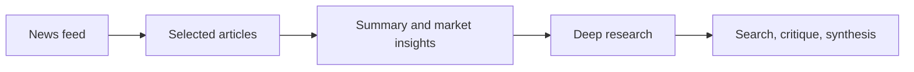

# TRUTH

**A prototype for turning financial news into an interactive research workflow.**

TRUTH brings a news feed, AI-generated market summaries, and deeper research into one web interface. The Flask backend combines a news source with local Ollama models and web search, while the frontend displays results and progress events.



## What is here

- **Feed:** retrieve financial articles or use built-in demonstration data when no NewsAPI key is configured.
- **Summary and insights:** analyze selected articles with a local language model; responses can include market scenarios and product suggestions.
- **Deep research:** gather search results, generate follow-up questions and synthesize a report. Progress is sent as server-sent events.
- **Local model serving:** the prototype calls Ollama rather than embedding a model or credential in the repository.

## Run locally

Requires Python 3.10+, [Ollama](https://ollama.com/), and the models named in the source. Install dependencies in a virtual environment:

```bash
python -m venv .venv
source .venv/bin/activate
pip install -r requirements.txt
cp .env.example .env
ollama pull gemma3:1b
ollama pull qwen3:8b
python app.py
```

Open `http://127.0.0.1:5001`. Set `NEWS_API_KEY` in `.env` for live news; without it the feed uses demonstration items. Model-backed analysis requires a running Ollama service. Search and provider availability can affect results.

## Project map

| Path | Purpose |
| --- | --- |
| `app.py` | Flask routes, search, analysis, and streaming progress |
| `crawler.py` | NewsAPI retrieval and article summarization |
| `product_recommender.py` | Market scenario and product recommendation logic |
| `static/` | Browser interface |

## Boundaries

This is an experimental research tool, not investment advice. Model output and source credibility require human review. The original local news cache and environment file are not included; the app creates its own cache at runtime. Optional deposit-product data was absent from the source snapshot, so data-backed product matching may be unavailable. The development server binds to localhost in this public edition.
